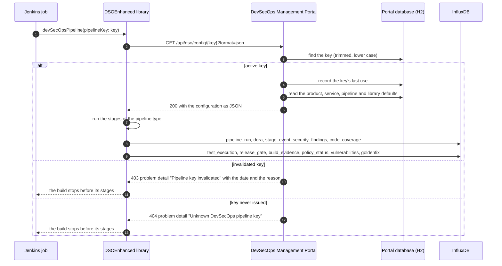
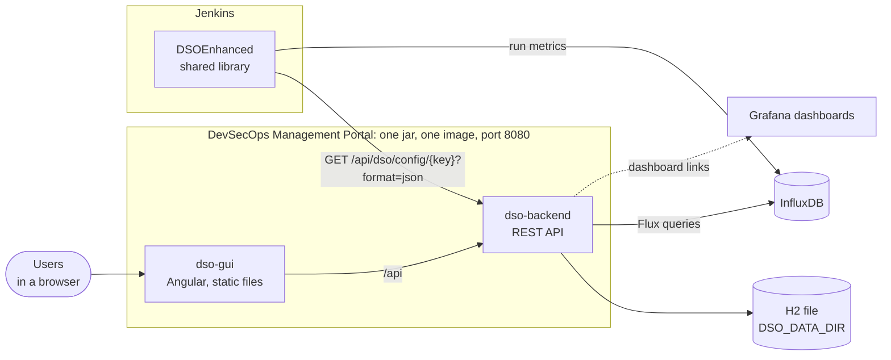
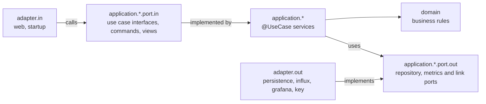
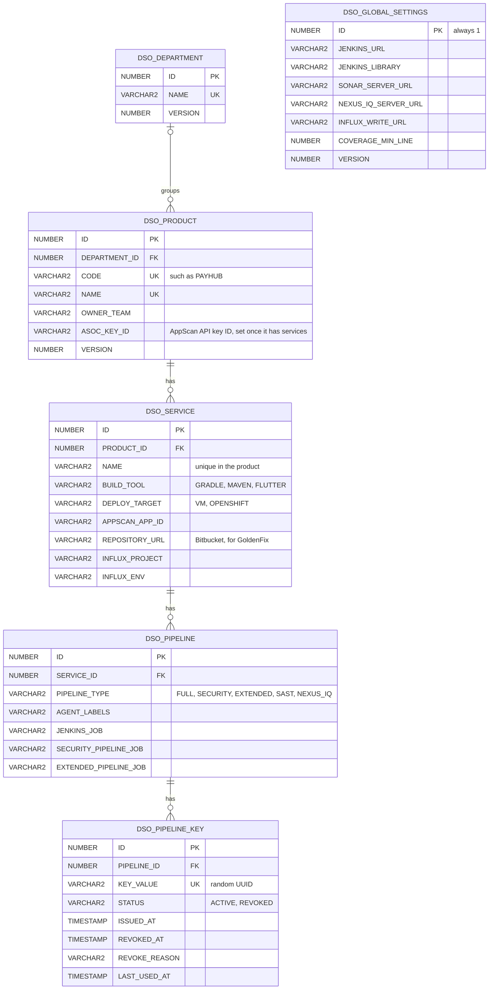

# BBH DevSecOps Management Portal

The web application of BBH's DevSecOps: it onboards products to DevSecOps, manages their pipelines and pipeline
keys, watches the pipelines, and serves the configuration the Jenkins library
[DSOEnhanced](https://github.com/mateuszmatan/DSOEnhanced) reads. The portal (`dso-portal`) is an Angular GUI and a
Spring Boot service, packaged as one jar with the GUI inside and as one container image, with its own database.

Until 2026-10-16 this repository also held Beadle, the application that raises ProTech changes for production
releases. On that day Beadle was split out into repositories of its own,
[Beadle-GUI](https://github.com/mateuszmatan/Beadle-GUI), [Beadle-Internal](https://github.com/mateuszmatan/Beadle-Internal)
and [Beadle-ProTech](https://github.com/mateuszmatan/Beadle-ProTech), and this repository holds the DevSecOps
Management Portal alone; the screenshots under `examples/screenshots` up to v18 still show both applications.

## Repository layout

```
settings.gradle, build.gradle   the root build: modules, repositories, versions, how the application is packaged
common-backend/                 code the portal service builds on: departments, errors, use case wiring, GUI forwarding
dso-backend/                    the DevSecOps Management Portal service (Spring Boot, port 8080)
common-gui/                     the Angular code the interface builds on: shell, UI kit, departments, admin page
dso-gui/                        the DevSecOps Management Portal interface (Angular)
angular.json, package.json      the Angular workspace of the two GUI modules
deploy/openshift/               Dockerfile notes and the Kustomize manifests of the portal
examples/                       Jenkinsfiles, API calls, a rendered configuration and GUI screenshots
```

| Module | Holds |
|--------|-------|
| `common-backend` | the departments (domain, use case and `/api/departments`), the problem detail error handling, the `@UseCase` transaction wiring, the clock, the forwarding of the GUI pages to `index.html`, the Liquibase history the portal's database starts from and the test support of the service |
| `dso-backend` | products with their services and settings, pipelines and keys, the library defaults and the service template, the configuration rendered for DSOEnhanced, and the monitoring on InfluxDB and Grafana |
| `common-gui` | the application shell (header, menu, footer, titles), the UI kit (form fields, grid, chart, dialogs, toasts), the departments pages and dialogs, the Admin page with its tabs, the API error texts and the browser test support |
| `dso-gui` | Pipelines, Self-service, Pipeline Monitoring and DevSecOps Admin (Departments, Products, Service template, Library defaults) |

The common modules hold the code that is tied to no section of the portal; everything that belongs to a section of
the portal lives in `dso-backend` and `dso-gui`.

## Build

Needs Java 17, and Node.js 20.19 or a later 20.x with npm 10.8 or a later 10.x on the `PATH` (the build calls `npm`
and `npx` from there, or the paths in `npm.executable` and `npx.executable` of `gradle.properties` when those files
exist). The Gradle wrapper downloads Gradle 8.14 from the BBH Nexus.

```bash
./gradlew build                     # the jar with the GUI inside and every test suite
./gradlew dsoJar                    # the jar alone: dso-backend/build/libs/dso-portal-<version>.jar
./gradlew :dso-backend:bootJar -PskipGui   # the service without its GUI, for API work
./gradlew check                     # every suite of every module, see Tests
./gradlew sonar                     # SonarQube at tools.bbh.com/sonar, project DSOMgmtPortal, token in SONAR_AUTH_TOKEN
./gradlew publish                   # the jar to the BBH Nexus (bbhNexusUsername and bbhNexusPassword as Gradle properties)
./gradlew dsoJar -PartifactVersion=1.4.0
```

`dsoJar` builds the application: `dso-backend` depends on `common-backend` and takes the bundle of `dso-gui` into its
`static` folder. `publish` sends a `-SNAPSHOT` version to `nexus.snapshotsUrl` and any other to `nexus.releasesUrl`,
both in `gradle.properties`.

| File | Holds |
|------|-------|
| `settings.gradle` | the four modules; whether the BBH Nexus is reachable, and the repositories that follow from it |
| `build.gradle` | the plugins, Java 17, SonarQube, the npm tasks and test suites of the GUI modules, the test suites and coverage gate of the backend modules, and how the application packages and publishes its jar |
| `<module>/build.gradle` | the dependencies of that module |
| `gradle.properties` | the BBH npm registry, proxy and CA file, the `npm`/`npx` paths on Windows and the Nexus URLs |
| `gradle/libs.versions.toml` | the plugin and library versions |
| `gradle/wrapper/gradle-wrapper.properties` | Gradle 8.14 from the BBH Nexus |
| `angular.json`, `package.json`, `.npmrc` | the Angular workspace: the projects `common-gui` and `dso-gui`, the BBH npm registry and the Node.js and npm versions as hard requirements |

The GUI tasks run npm with the `npm.*` properties of `gradle.properties` as npm settings: `installNpmCIDeps`
(`npm ci`), `installDesignSystem` (`npm install --no-save` of the BBH Design System packages `@v6/v6-themes`,
`@v6/v6-table` and `@v6/v6-icons`, inside BBH only), and per GUI module `buildAngular` (`npx ng build <module>
--configuration=production` into `<module>/dist`) and `testAngular` (`npx ng test <module> --watch=false --coverage`,
Vitest on jsdom, so it needs no browser). The `processResources` of a service depends on the `buildAngular` of its GUI,
so `bootJar`, `bootRun` and the smoke tests always carry the current GUI; `-PskipGui` leaves it out.

The BBH Design System packages live only in the BBH npm registry, so `package.json` does not list them and `npm ci`
works anywhere. `-PdesignSystem.packages="@v6/v6-themes@21 @v6/v6-table @v6/v6-icons"` names other versions. The
tables use `ag-grid-enterprise` with only AG Grid's community features so far, so they need no licence; the build hands
BBH's licence key to AG Grid for the day an Enterprise feature is added: `-PagGridLicenseKey=...` or the
`AG_GRID_LICENSE_KEY` environment variable.

### Inside and outside the BBH network

The BBH Nexus, the BBH npm registry and the `njproxy` proxy only answer inside BBH, and the build needs no setting to
know where it is. `settings.gradle` asks the BBH Nexus for the Gradle distribution of the wrapper with one `HEAD`
request (3 seconds to connect): when it answers, plugins and libraries come from the BBH Nexus repositories, npm
packages from `tools.bbh.com/nexus/repository/npm-group` through `njproxy` with the BBH CA file, the Design System is
installed and the GUIs build with the BBH Design System. When it does not, the build says so once ("The BBH Nexus is
out of reach") and uses the Gradle Plugin Portal, Maven Central and `https://registry.npmjs.org/`
(`npm.publicRegistry` names another), switches the `njproxy` proxy properties off, skips `installDesignSystem` and
builds the GUIs with the `public` configuration, which swaps the BBH Design System styles and icons for a navy Bootstrap
theme with the same layout. The same build therefore works on a BBH workstation and on any other machine.

`-PbbhNetwork=true` or `false` (also as `bbhNetwork=` in `~/.gradle/gradle.properties`) overrides the check. The
wrapper's own Gradle download sits on the BBH Nexus too, so `gradlew` and `gradlew.bat` make the same check before
they start: when the BBH distribution does not answer, they run the wrapper from a copy in `.gradle/public-wrapper`
whose `distributionUrl` points at `https://services.gradle.org/distributions/gradle-8.14-all.zip`, and Gradle 8.14
is downloaded from there once. `./gradlew build` is therefore the same command everywhere. A machine behind its own
proxy sets `systemProp.https.proxyHost` and `systemProp.https.proxyPort` in `~/.gradle/gradle.properties`, which win
over the project's. Running npm by hand outside BBH needs `--registry=https://registry.npmjs.org/`.

## Running locally

Build the jar and start it; it serves the GUI and the API on port 8080.

```bash
./gradlew dsoJar
java -jar dso-backend/build/libs/dso-portal-0.1.0-SNAPSHOT.jar        # http://localhost:8080
```

`./gradlew :dso-backend:bootRun` does the same without building the jar.

The portal starts with an empty, persistent database: an embedded H2 in Oracle mode in the
file `~/bbh-devsecops/dso-portal/dso-portal.mv.db` (`DSO_DATA_DIR` moves the folder). Liquibase creates the schema on
the first start with the five BBH departments (AI Lab, Capital Partners, Corporate Technology, Custody and Fund
Services) and the BBH library defaults, and nothing else: no product, service, pipeline or key is made up, so the
portal can be used for real from the first start. Every later start finds the data where it was left; the schema is
updated in place when a new version adds to it. The database file is the portal's data: back up the folder, and move
it with `DSO_DATA_DIR` when the portal moves. The portal has no Oracle profile: whichever profile is switched on, it
stays on its H2 file (`rd` only turns the logging up to DEBUG). `DB_USERNAME` and `DB_PASSWORD` protect the H2 file
(`sa` without a password by default, set them before the first start). Pipeline Monitoring reads
InfluxDB, so without `INFLUX_URL` it says that the administrator has to set it and shows no runs:

```bash
INFLUX_URL=https://influx.example.com INFLUX_TOKEN=... \
GRAFANA_DASHBOARD_URL=https://grafana.example.com/d/adzfc54123/devsecops-pipeline-long \
GRAFANA_SECURITY_DASHBOARD_URL=https://grafana.example.com/d/ad2trcm/devsecops-pipeline-security \
  java -jar dso-backend/build/libs/dso-portal-0.1.0-SNAPSHOT.jar
```

The dashboards are the ones DSOEnhanced ships (`grafana/` in that repository); the portal opens them with the
service's `project` variable and the selected time range. Security, SAST and Nexus IQ GoldenFix pipelines open the
security dashboard, the other pipelines the pipeline dashboard. Grafana must let portal users view them. A second
Grafana instance takes `GRAFANA_2_DASHBOARD_URL` and `GRAFANA_2_SECURITY_DASHBOARD_URL`, and each instance is named
with `GRAFANA_NAME` and `GRAFANA_2_NAME` (`Grafana` and `Grafana 2` when unset). The pipeline page then embeds the
dashboard of every instance that has one for the pipeline, under the instance's name, so two Grafanas can share the
dashboards, or one can hold the pipeline dashboard and the other the security one. An instance without the security
dashboard shows its pipeline dashboard for security pipelines too, and an instance without the pipeline dashboard
shows nothing for the other pipelines.

A database that earlier versions wrote to `./data` next to the jar is not reused: the portal starts its own database
at its new location (see [Data model](#data-model)).

For GUI work, the Angular development server rebuilds on every change and proxies `/api` to the service: `npm start`
serves `dso-gui` on http://localhost:4200 against port 8080, and `npm run start:public` does the same without the BBH
Design System.

### Configuration

The service reads `bbh-devsecops-common.yml` from `common-backend` (JPA, Liquibase, actuator health and info) and its
own `application.yml`:

| Variable | Default | Meaning |
|----------|---------|---------|
| `PORT` | `8080` | HTTP port |
| `DSO_DATA_DIR` | `~/bbh-devsecops/dso-portal` | the folder of the H2 database `dso-portal.mv.db` |
| `DB_USERNAME`, `DB_PASSWORD` | `sa`, empty | the H2 user; set before the first start, since H2 creates the user with the database |
| `SPRING_PROFILES_ACTIVE` | none | `rd` logs the portal at DEBUG; `qc` and `prod` change nothing yet |
| `INFLUX_URL`, `INFLUX_TOKEN` | empty | your InfluxDB; empty switches Pipeline Monitoring off and tells the administrator what to set |
| `INFLUX_ORG`, `INFLUX_BUCKET` | `DevSecOps`, `DORA-metrics` | where DSOEnhanced writes its metrics |
| `GRAFANA_DASHBOARD_URL` | empty | link to the DSOEnhanced pipeline dashboard; empty leaves this instance without one, and without any link the pipeline page shows no dashboard |
| `GRAFANA_SECURITY_DASHBOARD_URL` | empty | link to the security dashboard for `SECURITY`, `SAST` and `NEXUS_IQ` pipelines; empty uses the pipeline dashboard |
| `GRAFANA_NAME` | `Grafana` | the name of that Grafana instance on the pipeline page |
| `GRAFANA_2_DASHBOARD_URL`, `GRAFANA_2_SECURITY_DASHBOARD_URL`, `GRAFANA_2_NAME` | empty, empty, `Grafana 2` | the same for a second Grafana instance; both empty links leave it out |

Liquibase creates and updates the schema at start-up. Secrets never reach the portal: services name Jenkins
credentials IDs, and the generated configuration carries only those IDs.

## Containers and OpenShift

The service has its Dockerfile (`dso-backend/Dockerfile`: UBI 9 with Java 17, any non-root UID, the Spring Boot layers
extracted) and its Kustomize manifests with `rd`, `qc` and `prod` overlays (`deploy/openshift/dso-portal`). The image
keeps its H2 database on a persistent volume at `/application/data`.
[deploy/openshift/README.md](deploy/openshift/README.md) describes building, running and deploying the image.

## The DevSecOps Management Portal

The portal's menu has four sections:

- **Pipelines**: the DevSecOps pipelines of your department. Pick your department (the browser remembers it) and see
  its pipelines in a table you can sort and filter in the header: service, product, pipeline type, Jenkins job,
  pipeline key (by its hint, or Invalidated), the result of the last run and when it finished. **Set up pipelines in
  Self-service** opens the wizard. **Edit** in a row changes the pipeline's Jenkins agents, Jenkins job and
  description; when someone else saved the pipeline meanwhile, the dialog loads their settings and says so, so you
  make your change again on top of them. A row opens the page of its pipeline: the result of its last run, the
  pipeline key (shown on request and copied whole) with when it was issued and last used by Jenkins, its settings, the
  Jenkinsfile ready to copy and up to five of its latest runs of the past 30 days, with **Open in Jenkins** and a link
  to every run and the delivery performance (DORA) in Pipeline Monitoring. **Edit settings** opens the same dialog,
  and its **More** menu opens the product in Admin, shows the settings sent to Jenkins (config.yaml) and the key
  history, replaces or invalidates the key and deletes the pipeline; an invalidated key is regenerated with one button.
- **Self-service**: a step-by-step wizard for app owners who do not know DevSecOps. It sets up a new product or
  changes one already in the portal: choose the department and the product, then the pipeline, in this order: SAST
  (Static Application Security Tests) - HCL AppScan, OSA (Open Source Analysis) (NexusIQ with Golden Fix and Golden Pull
  Request), Security (Unit Tests, NexusIQ, SAST, SonarQube) or Full (Static Security (unit test, NexusIQ, SAST,
  SonarQube) + Extended (lower test region deployment, regression, performance, smoke, DAST, higher test region
  deployment)); for a product in the portal the step shows which pipelines each service has today and how many
  services already have each one. Then the services: add new ones (name, AppScan application, Gradle or Maven, virtual
  machines or OpenShift; for OSA also the Nexus IQ application and the Bitbucket repository of each service), change
  the existing ones (including their build tool and where they run) or remove them. Each step asks one question, and
  the button at the bottom names the next step (**Next: Services**). The review ("Is everything right?") says what
  happens to each service, tagged New, Changed or Removed, and which pipelines a removal deletes; nothing is saved
  until **Create the pipelines** (**Save the changes** for a product in the portal). The last step lists what to do
  next in order: the Jenkinsfile of each service ready to copy, with the repository it goes into, the Jenkins job to
  ask for per service, the first run and where to follow the results. The build tool and where a service runs start
  from the library defaults; the OpenShift project, the Nexus IQ application, the Bitbucket repository, the build and
  the Jenkins job of each pipeline are filled in from the service template, and every value can be changed. New
  services, and services that change their build tool or where they run, wait for the service template: when it
  cannot be loaded, the Services step says so and offers **Try again**. Everything else comes from the BBH library
  defaults and can be fine-tuned in Admin.
- **Pipeline Monitoring**: "Latest results" counts the pipelines and how their latest runs ended (Passed, Failed or
  passed with warnings, Keys invalidated), with a chart of them by department; "Products" lists every product with
  the results of its pipelines, grouped by department; "Delivery performance (DORA)" rates the four DORA measures of
  all pipelines over the last 30 days (today and the 29 days before it, in UTC, so the totals add up to the daily
  bars) as Elite, High, Medium or Low, each with a one-line meaning, above their runs per day. A product shows each
  pipeline with its latest run and how many of its stages passed; a pipeline shows its delivery performance, runs per
  day, latest run, recent runs, the Jenkins job and your DSOEnhanced Grafana dashboard over a period of 7, 30, 90 or
  180 days, and names the time zone of its times. Everything is read from the InfluxDB the pipelines write to. A run
  reads Passed, Passed with warnings, Failed, Stopped or Not built; a pipeline without runs shows No runs yet, and one
  whose key was invalidated Key invalidated.
- **Admin**, for the portal administrator, in four tabs:
  - **Departments**: add, rename and delete departments (only an empty one can be deleted, and a disabled Delete says
    why), each with the number of its products, services and pipelines ("12, all active" or "12, 2 keys
    invalidated"), and the chart "Pipelines per department" of the active pipelines and those whose key was
    invalidated. The five BBH departments come with the database.
  - **Products**: add a product with all of its services and every setting the DevSecOps library reads from
    `config.yaml` today, edit or delete it. Every new service gets a full pipeline with its own key; keys can be
    invalidated, regenerated and linked to a Jenkins job, and each service names the Bitbucket repository where
    DSOEnhanced raises its GoldenFix pull requests. The product page lists each service with its build tool, where it
    is deployed, its Bitbucket repository and its pipelines with their key, Jenkins job, Jenkins agents and monitoring
    tags; **Edit product** opens the editor, **Add pipeline** adds a pipeline to a service, and the **More** menus of
    the product and of each pipeline hold the rest: the settings sent to Jenkins (config.yaml), monitoring, the
    Jenkinsfile, the key history, the pipeline settings, the key actions and deleting. In the editor **Edit settings**
    opens a service, and the rarely changed settings of a section sit in its collapsed **Advanced settings** panel,
    which opens by itself when a field in it needs attention.
  - **Service template**: what a new service and a new pipeline get, in Self-service and in the Add service and Add
    pipeline forms: the Jenkins agents and job of a pipeline, the Gradle and Maven tasks and artifacts, the Nexus IQ
    application, scan patterns and Bitbucket repository, and the OpenShift project, image registry and health check.
    The names take the placeholders `{CODE}` (the product code), `{code}` (the same in lower case) and `{service}`,
    and the job also `{type}` (full, security, extended, sast or nexusiq), so `DevSecOps/{CODE}/{service}-{type}`
    names the full pipeline of `backend-api` in CERT `DevSecOps/CERT/backend-api-full`. The panel "What a new service
    gets" shows what a service gets while you type and what each placeholder stands for.
  - **Library defaults**: the DSOEnhanced library defaults every pipeline shares, in the sections Tools and servers,
    Deployment defaults, Security limits, Scans and coverage, Release gate, Service defaults and GoldenFix defaults.
    They replace the library's `defaults.yaml`. A service can set its own SonarQube, Nexus IQ and InfluxDB values and
    its own deployment, service and GoldenFix values in the product editor. **Show settings sent to Jenkins** shows
    the part of `config.yaml` every pipeline receives, built from the saved defaults. The open source scan (SCA) has
    only its security limits, and the release gate result file is always `release-gate.json`, the one file the
    security pipeline archives and the extended pipeline copies, so it is shown read-only and always sent.

No `config.yaml` remains in the product repositories. The portal-integrated library reads each pipeline's
configuration from the portal by its key, so a service needs only the generic Jenkinsfile and its pipeline key:

```groovy
@Library('DevSecOpsJenkinsLibrary') _

devSecOpsPipeline(pipelineKey: '6f1c2d3e-0000-4abc-9def-123456789abc')
```

A run that builds several services of one product passes the keys of their pipelines of that type, the primary service
first; the product page offers this Jenkinsfile as "Jenkinsfile for several services" in the **More** menu of a
pipeline, and the page of a pipeline in Pipelines shows its own. Extended pipelines join only when they name the same
security pipeline, since the run reads the security run state of the primary's only:

```groovy
devSecOpsPipeline(pipelineKeys: ['6f1c2d3e-0000-4abc-9def-123456789abc', 'a1b2c3d4-0000-4abc-9def-123456789abc'])
```

During the cutover, pin the portal-integrated library version (for example `DevSecOpsJenkinsLibrary@main`) in the
shared library of Admin > Library defaults (`platform.jenkinsLibrary`, the name the generated Jenkinsfiles load) and in
the `@Library` line of every migrated job, until every job carries a key.

### How DSOEnhanced reads its configuration

| Request | Answer |
|---------|--------|
| `GET /api/dso/config/{key}` | 200 with the pipeline's `config.yaml` (`?format=json` for JSON), recording the key's last use; 403 with the reason once the key is invalidated; 404 for a key never issued |
| `GET /api/pipelines/{id}/config` | the same configuration for the portal UI, without recording a use |
| `GET /api/products/{id}/config` | every service of a product as one `config.yaml` |
| `GET /api/settings/config` | the part of every configuration that comes from the library defaults |

The library reads each pipeline's configuration from the portal over HTTPS, with one
`GET /api/dso/config/<key>?format=json` per key, sent with `curl` from a Jenkins agent before the pipeline starts.
The portal renders the configuration from its database at that moment and records the key's last use. Jenkins needs
only the portal's address, the global environment variable `DSO_PORTAL_URL` (for example
`https://dso-portal.apps.bbh.com`); it holds no database account, no credentials and no driver, and only the portal
reaches its database. Jenkins jobs never reach that database: the library asks for the configuration by key, writes
its run metrics to InfluxDB, and raises its GoldenFix pull requests in the service's Bitbucket repository; the portal
reads the metrics back for Pipeline Monitoring and links the DSOEnhanced Grafana dashboards.



The key is the only check. Whoever holds a key reads the configuration of that one pipeline, which names Jenkins
credentials IDs and no passwords, much as anyone who could read a product repository could read its `config.yaml`.
Keys are random UUIDs, the API lists none of them by this request, and an invalidated key is refused with 403 at once.
When the portal moves behind BBH SSO, `/api/dso/config/**` stays outside the sign-in.

Every key the library reads per service is a setting of the service. A service may name its own Nexus IQ server and
credentials, SonarQube server, InfluxDB write URL and credentials, and AppScan secret (a Secret text credentials ID);
left empty, the configuration carries the library default or, for the AppScan secret, the product's. One Nexus IQ
application is written as `tools.nexusIq.application: <name>`; several are written as a map of applications, each
entry with its scan patterns, stage and the effective server and credentials.

A pipeline's metrics are matched by the InfluxDB tags the library writes: `project` (the service's metrics project
plus the pipeline type suffix: none for full, `security`, `extended`, `sast`, `nexusiq`) and `env`. Several services
may share one metrics project and env. Under a shared tag a `pipeline_run` belongs to the pipeline whose Jenkins job
(or a branch of it) recorded it in the `job` field; a pipeline without a Jenkins job shows no run, and a run of one job
building several services belongs to each of them. DORA metrics and the Grafana dashboard stay per tag. Concurrent runs
under one tag can still mix the points the library writes without a `module` tag.

### Nexus IQ GoldenFix pipeline

A Nexus IQ GoldenFix pipeline (`NEXUS_IQ`, Jenkinsfile `devSecOpsNexusIqGoldenFixPipeline(pipelineKey: '<key>')`,
job `DevSecOps/<CODE>/<service>-nexusiq`) runs three stages: *Monitor source changes (download sources)*, *Build
artifact* and *Dependencies scan (Nexus IQ)*. When the scan reports a policy violation, GoldenFix applies the upgrades
Nexus IQ offers and raises the golden pull request `GoldenFix-<yyyyMMddHHmm>` in the service's Bitbucket repository.
The pipeline deploys nothing and runs no other scan.

Its configuration (`pipeline.type: nexusiq`) carries the service's settings like any other pipeline and links no
security or extended job. The service needs its Nexus IQ applications, with scan patterns that match the artifacts the
build produces; its Bitbucket repository and credentials ID (`scm.bitbucket`), without which the library records
`NOT_CONFIGURED` and raises no pull request; GoldenFix switched on, by the service's own switch or by the GoldenFix
defaults of the library defaults; and an AppScan application, which every service keeps whatever its pipelines. Its
metrics carry the project suffix `nexusiq` and its Grafana links open the security dashboard of every instance.

### Accepted differences from config.yaml

Moving the configuration into the portal changes these behaviours of the library on purpose:

1. Configuration lives in the portal, not in the repository: no per-branch, per-PR or per-commit configuration; a
   replay of an old build uses today's portal values; release and develop jobs of one service share one pipeline per
   type. The console, the report header and `build_evidence` record the key hint, `renderedAt` and the sha256 hint.
2. Failures before `pipeline {}` leave no report, `release-gate.json` or InfluxDB point; `build_duration` and the DORA
   duration include the bootstrap read.
3. The archived run-state file is `pipeline-config.yaml`, not `config.yaml`; the first extended run after cutover needs
   one security build made by the new library.
4. The extended pipeline uses its own key's projects plus the security run's run-time tags, not the security run's
   whole `config.yaml` copy.
5. Keys the portal does not model are gone from `getCFG()` (custom keys a team added to `config.yaml`);
   `tests.<suite>.defaults`, bare-string test jobs and `urls` are expanded by migration into jobs; `jobs[].auth` maps
   other than credentials IDs, OpenShift `appName`/`imageNamespace`/`cluster`/`credentialsId` (only the unused
   nexusDelivery API reads them) and the keys the library no longer reads are not modelled.
6. Selecting projects through `PROJECT_NAMES`/`PROJECT_NAME` without keys is gone; the keys decide.
7. Texts that named `config.yaml`/`defaults.yaml` now name the portal, also where they reach the report,
   `release-gate.json` and InfluxDB. A Jenkinsfile `securityPipeline` in a full, security, SAST or Nexus IQ GoldenFix
   pipeline is ignored, which shows the Nexus IQ and SonarQube summary rows it used to hide.
8. Nexus IQ report links appear for every service, because the IQ server URL is a library default (GoldenFix stays
   governed by its own per-service switch).
9. Every build depends on the portal at start; the agents of the `DSO_PORTAL_AGENT` label need HTTPS access to it.

### REST API of the portal

| Method and path | Purpose |
|-----------------|---------|
| `GET /api/departments` | departments by name, each with the number of its products, their services, their pipelines and the pipelines with an active key |
| `POST /api/departments`, `PUT`/`DELETE /api/departments/{id}` | add, rename or delete a department; `PUT` carries the `version` it was read at; a department that still has products is not deleted (409) |
| `GET /api/products?search=` | products with their department, service and pipeline counts; the search also matches the department name |
| `POST /api/products`, `GET`/`PUT`/`DELETE /api/products/{id}` | a product in its department (`departmentId`, required on every save) with its complete list of services and its AppScan account (`appScan`, whose `keyId` is required once the product has a service); `PUT` carries the `version` it was read at; every service the save creates gets a full pipeline with an active key, or with `?pipelineType=SAST\|NEXUS_IQ\|SECURITY\|FULL` every service of the product without a pipeline of that type gets one; `DELETE` removes the product with its pipelines and keys |
| `GET /api/products/code-suggestion?name=` | the code the portal suggests for a new product's name: its letters and digits in upper case, with a number added when another product has that code |
| `GET /api/products/{id}/pipelines` | each service of a product with its pipelines |
| `POST /api/services/{id}/pipelines` | add a pipeline; it starts with an active key |
| `GET /api/pipelines?departmentId=` | the pipelines of a department's products as `{pipelines, metricsError}`, by product and service, each with its status and last run and its key by its hint; 404 for an unknown department |
| `GET`/`PUT`/`DELETE /api/pipelines/{id}` | a pipeline with its key history and its `version`; `PUT` may carry the `version` it was read at (409 when stale) |
| `POST /api/pipelines/{id}/keys` | issue a new key; an active key is invalidated with the reason "Replaced by a new key"; on a pipeline whose key was invalidated this is Regenerate, and the old keys stay refused |
| `POST /api/pipelines/{id}/keys/revoke` | invalidate the active key, with a `reason` of at most 500 bytes; 409 when the pipeline has no active key |
| `GET /api/dso/config/{key}`, `GET /api/pipelines/{id}/config`, `GET /api/products/{id}/config`, `GET /api/settings/config` | the DSOEnhanced configuration as YAML, or as JSON with `?format=json`; see [How DSOEnhanced reads its configuration](#how-dsoenhanced-reads-its-configuration) |
| `GET /api/monitoring/status`, `/products`, `/products/{id}`, `/pipelines/{id}?range=30d` | monitoring data; `status` says whether InfluxDB is configured and reachable and names the Grafana instances |
| `GET /api/monitoring/activity?range=30d` | the DORA summary and the daily activity of all pipelines together, as `{pipelines, dora, metricsError}`: the number of pipelines, the DORA metrics over the range with `dora.daily` (runs, failures and deployments per day), and the metrics error, if any |
| `GET`/`PUT /api/settings` | the DSOEnhanced library defaults (Admin > Library defaults); `PUT` carries the `version` it was read at |
| `GET`/`PUT /api/service-template` | the template of a new service (Admin > Service template): `agentLabels`, `jenkinsJob`, the Gradle, Maven and Flutter tasks, artifacts and scan patterns, `deliveryTasks`, `nexusIqApplication`, `repositoryUrl`, `bitbucketCredentialsId`, `openShiftProject`, `imageRegistry` and `healthCheckUrl`; `version` is `null` until it is saved (it then holds the BBH defaults), and `PUT` carries the `version` it was read at (409 when stale); a placeholder other than `{CODE}`, `{code}`, `{service}` (and `{type}` in the job) is refused, and so is a name too long for its column once the longest code and service name are filled in |

A `range` is a number of days from `1d` to `730d`, `30d` when left out. Errors are RFC 9457 problem details;
validation errors name the failing fields, for example `services[2].build.javaPath`. Key values are only sent by the
product management endpoints, and only for the active key; everywhere else a key shows as its hint.

## Architecture



The service is `dso-backend` on top of `common-backend`. Each backend module
(`<module>/src/main/java/com/bbh/itss/dso/portal`) is hexagonal:

| Package | Holds |
|---------|-------|
| `domain` | plain Java: in `common-backend` the departments and the shared value rules; in `dso-backend` products, services and their settings, pipelines and keys, the library defaults, the service template, the rendered configuration and DORA metrics; every business rule lives here |
| `application` | the use cases behind ports, per area (`catalog` in both modules, `dsoconfig`, `monitoring`, `pipeline` and `settings` in `dso-backend`), each with its `port.in` and `port.out` packages; `@UseCase` classes become transactional beans, without Spring in the code |
| `adapter.in` | Spring MVC controllers with the request and response records (`web`), the forwarding of the GUI pages to `index.html` (`SinglePageAppForwarding`, which reads the pages of the application from `dso.gui.pages`), and the start-up tasks (`startup`) |
| `adapter.out` | JPA entities and Spring Data repositories (`persistence`), the InfluxDB client (`influx`), the Grafana links (`grafana`) and the key generator (`key`) |
| `config` | the wiring of use cases, transactions and the clock, in `common-backend` |



ArchUnit tests in `dso-backend` keep the domain and the use cases free of Spring, JPA and Jackson, and keep the
adapters apart: the domain depends only on the JDK, Lombok and Apache Commons, the application only on the domain
and the same libraries, `adapter.in` never on `adapter.out` or a `port.out`, `adapter.out` never on `adapter.in`,
and every `@UseCase` class implements a `port.in` interface.

The GUI modules follow the same cut: `common-gui/src` holds the shell (`shell/`), the UI kit (`ui/`), the core
(`core/`: API base, models, errors, titles, the `appConfig` an application starts with), the departments
(`departments/`), the Admin page (`admin/`), shared forms and dialogs (`shared/`) and the test support (`testing/`,
and the Groovy fixtures of the browser tests in `src/testFixtures`); `dso-gui/src/app` holds the sections of the
portal (`core/` with its API clients, models and sections, then one folder per section), importing the common code as
`@common/...`. The application is `appConfig('<name>', routes)` with an `AppShell` that lists its sections;
[dso-gui/README.md](dso-gui/README.md) describes the GUI.

### Code conventions

- Static imports wherever the name stays clear on its own: enum constants, constants, `Collectors`, `Comparator`,
  `requireNonNull`, the Commons helpers. Generic names such as `List.of`, `Optional.empty` or `Product.restore` keep
  their class.
- Apache Commons (`StringUtils`, `ObjectUtils`, `BooleanUtils`, `CollectionUtils`, `ListUtils`) instead of repeated
  null and empty checks, for example `trimToNull(name)`, `getIfNull(tests, TestSettings.DEFAULTS)` or
  `List.copyOf(emptyIfNull(jobs))`.
- Lombok instead of hand-written constructors, accessors, builders and loggers. `lombok.config` makes accessors
  fluent (`id()`, like the records), and utility classes use `@NoArgsConstructor(access = PRIVATE)` rather than
  `@UtilityClass`, whose members javac cannot import statically. Entities never get `@Data` or `@EqualsAndHashCode`.
- No exception classes that only add a name. The code throws JDK exceptions with a message, and
  `ApiExceptionHandler` in `common-backend` maps them: `NoSuchElementException` is 404, `IllegalStateException` is 409
  (a clash with stored data or an outdated `version`), `SecurityException` is 403 (an invalidated pipeline key) and
  `InvalidRequestException`, the one exception of our own because it carries the failing fields, is 400. An
  `UncheckedIOException` from the metrics store becomes the metrics error of the page; anything else is a 500 and is
  logged, so a programming error throws `IllegalArgumentException` (for example `Validate.isTrue`), never
  `IllegalStateException`.
- Groovy specs and fixtures use Groovy's own `?.`, `?:` and the records' builders instead of Commons and Lombok, and
  keep GDK names such as `min` or `round` qualified.
- No comments in the code.

### Data model

The portal's database starts from the Liquibase history `common-backend/src/main/resources/db/changelog/history.yaml`
with the SQL files `001` to `025` under `oracle/`, so a database of earlier versions carries the same changesets as a
new one. That history was shared with Beadle until the split, and the portal's changeset `026-dso-tables-only.sql` in
`dso-backend` dropped Beadle's tables (change templates and production changes) from the portal's database, together
with the H2 metric store of the old demo data. Every later change lives in `dso-backend`, numbered from `027`. Most
changesets run on Oracle and on H2, a few on one of them only. The main tables of the portal:



A service has at most one pipeline of each type, and a pipeline at most one `ACTIVE` key; revoked keys stay as its
key history. `DEPARTMENT_ID` is empty only for a product saved before departments existed, and `ASOC_KEY_ID` only for
a product without services. The service settings that repeat live in child tables of `DSO_SERVICE`
(`DSO_SERVICE_TEST_JOB`, `DSO_SERVICE_SSH_TARGET`, `DSO_SERVICE_OPENSHIFT_TARGET`, `DSO_UCD_APPLICATION` with
`DSO_UCD_COMPONENT`, `DSO_SERVICE_NEXUS_IQ_APP`), and the scanners' severity limits in `DSO_GLOBAL_SEVERITY_LIMIT`.
The service template of Admin > Service template is the one row of `DSO_SERVICE_TEMPLATE`, written on its first save.

Oracle counts `VARCHAR2` columns in bytes, so the portal checks texts in UTF-8 bytes and refuses a longer one with 400
on its field ("is too long: it may take at most N bytes") instead of failing in the database: a product name and owner
team take 200 bytes, a service description 2000, a department name 100, a pipeline's Jenkins job and description 1000
each and the reason a key was revoked 500.

## Preconditions before wider use

The portal brings no BBH single sign-on with roles, no audit trail of who changed what and no history of the rendered
configuration; the owner decides on them later. Admin is open to every user until an administrator role exists. Until
they exist the DevSecOps Management Portal must not be reachable outside the test network, because a portal edit
steers every build and pipeline keys are bearer secrets.

## Examples

[examples/README.md](examples/README.md) describes the Jenkinsfiles of each pipeline type and of a run that builds
several services, `curl` scripts for the REST API of the portal, the configuration the library receives for a full
pipeline, and the screenshots of the GUIs per version.

## Tests

```bash
./gradlew check
```

builds everything and runs every suite of every module; `./gradlew :dso-backend:check` or `./gradlew :dso-gui:check`
runs the suites of one module, `./gradlew :dso-backend:regressionTest` one suite.

| Module | Suite | What |
|--------|-------|------|
| `common-backend`, `dso-backend` | unit (`src/test`) | domain rules, use cases, adapters and the architecture rules; JaCoCo fails below 60% line coverage per module (`-Pcoverage.minimum=`) |
| `dso-backend` | regression (`src/regressionTest`) | the API of the service end to end on H2 in Oracle mode, which checks the pinned configuration contract (`-Dregression.updateExpected=true` rewrites the expected files) |
| `dso-backend` | smoke (`src/smokeTest`) | starts the service on a fresh database and checks health, the API and that the GUI is served on every page; `-Dsmoke.baseUrl=https://...` checks a deployed application, `-Dsmoke.ui=false` skips the GUI checks |
| `dso-backend` | performance (`src/performanceTest`) | p95 latencies of the main calls, the configuration read by DSOEnhanced among them, on 25 products x 16 services |
| `common-gui`, `dso-gui` | unit (Vitest, `testAngular`) | components and form models; fails below 60% of lines and statements per module |
| `dso-gui` | smoke, regression (`src/smokeTest`, `src/regressionTest`) | Spock and Playwright in Chromium against a stub API of the portal: every page, the menu and the footer, the user journeys with the requests they send |
| `dso-gui` | performance (`src/performanceTest`) | page timings on a large catalogue |

`-Dperformance.factor=2` relaxes the performance limits on a slow machine.

## Known gaps

- The portal has no sign-in yet; see the preconditions above. Until BBH single sign-on exists, "your department" is
  the department the user last picked, remembered in the browser.
- The DevSecOps Management Portal runs on its H2 file only; moving it to Oracle means adding the Oracle profile and
  data source to `dso-backend/src/main/resources/application.yml` again.
